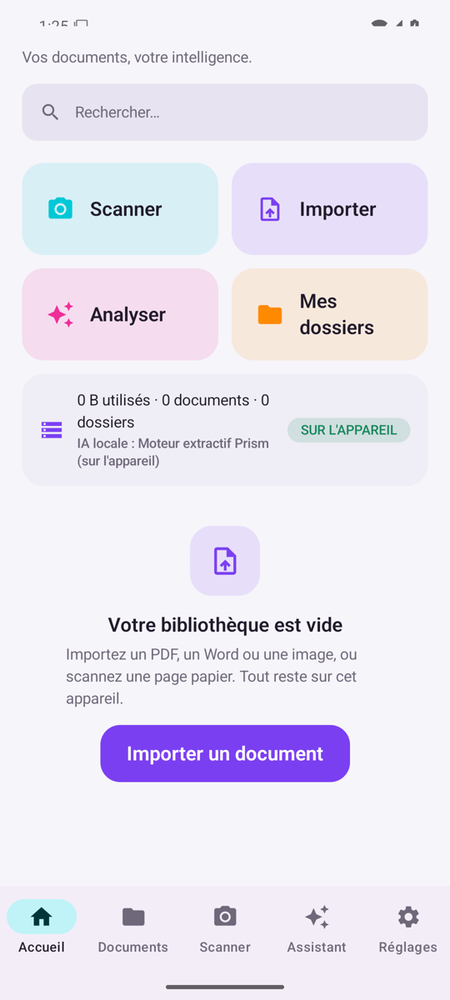
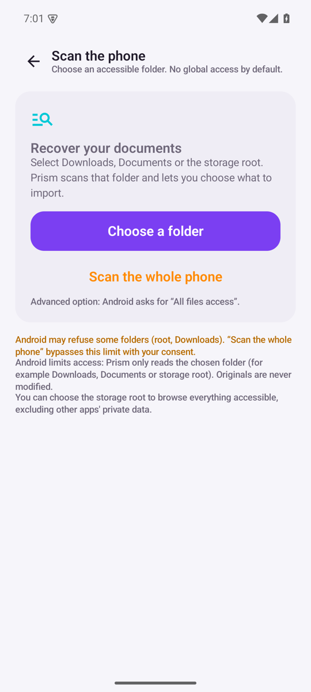

# Prism — APK (Android)

Gestionnaire documentaire **local-first** : import, lecture PDF, dossiers, scan du téléphone,
OCR on-device, opérations PDF non destructives et assistant local sourcé. Sans compte et sans
cloud IA par défaut.

## Télécharger

**[Prism v0.0.2 — APK debug](https://github.com/ilkinsem/Prism-Releases/releases/download/v0.0.2/app-debug.apk)**

- Android 8.0+ (`minSdk 26`), cible Android 15 (`targetSdk 35`).
- APK signé debug, à installer en sideload (autoriser les sources inconnues).
- Taille : ~70 Mo. SHA-256 : `cc1f05e63671246d1b6dc5a1ed941ad6584581aa5e94cab90972565469544589`.

Le dépôt de code source est **privé**. Ce dépôt public ne contient que les APK et leurs notes.

## Nouveautés v0.0.2

- **Scanner le téléphone** : balayage récursif d'un dossier choisi via SAF, ou option avancée
  « tous les fichiers » (consentement Android explicite) pour parcourir la racine/Téléchargements.
  Filtres PDF/Word/Images/Texte, sélection, import et progression.
- **Gestes Documents** : glisser une ligne à gauche ou à droite, ou toucher « … », pour révéler
  les actions (corbeille, couper/déplacer, tag, partage, favori). Aucune suppression immédiate.
- Correction du libellé « Documents » de la barre basse et validation du nom de dossier.
- Démarrage allégé (initialisation paresseuse PDFBox/ML Kit).

## Inclus

- Accueil, Documents, Scanner, Assistant, Réglages — **FR/EN**.
- Design Prism, thèmes clair/sombre, panneaux adaptatifs sans modale applicative.
- Import SAF, dossiers/sous-dossiers, favoris, récents, corbeille, tags, recherche nom/contenu,
  doublons SHA-256.
- Lecteur PDF : zoom, miniatures, texte, recherche, rotation, extraction/suppression, division.
  Chaque transformation crée un nouveau document ; l'original reste intact.
- Scanner CameraX + PDF multipage + OCR ML Kit.
- Assistant extractif sourcé (résumé, Q/R citées, extraction dates/montants/e-mails/références),
  multi-documents, historique et purge.
- Abstraction LLM : moteur embarqué par défaut ; Ollama/LM Studio debug-only, opt-in, hôtes privés.
- Prism est déclarée comme lectrice de PDF (`ACTION_VIEW` + `application/pdf`).

## Limites assumées

DOCX→PDF (moteur de rendu non embarqué), LFM3/llama.cpp natif Android, mesure OCR CER/WER,
Google Drive, signature cryptographique, caviardisation réelle, sync et performances sur appareil
physique. L'option « tous les fichiers » est avancée et doit être évaluée vis-à-vis des règles
Google Play avant une distribution publique.

## Vérifications

- E2E Compose : 7/7 (navigation, lecteur, dossiers, assistant, recherche, purge, swipe, scan).
- Couverture : domaine 91,8 %, core common 85,1 %.
- Build, installation et lancement vérifiés sur émulateur API 35.

Nom « Prism » provisoire. Version 0.0.2.
