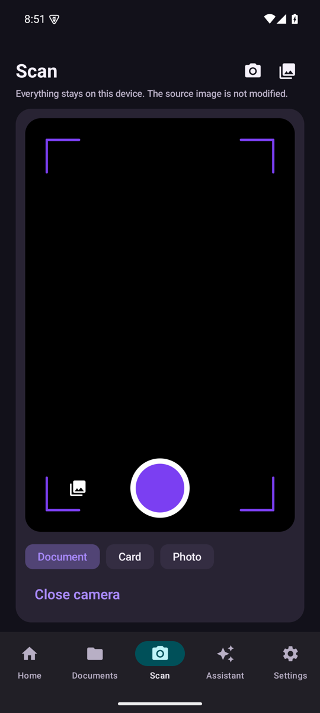
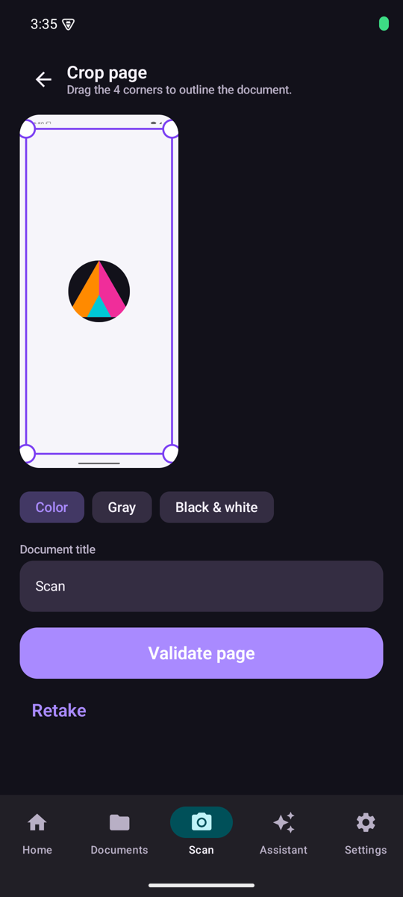
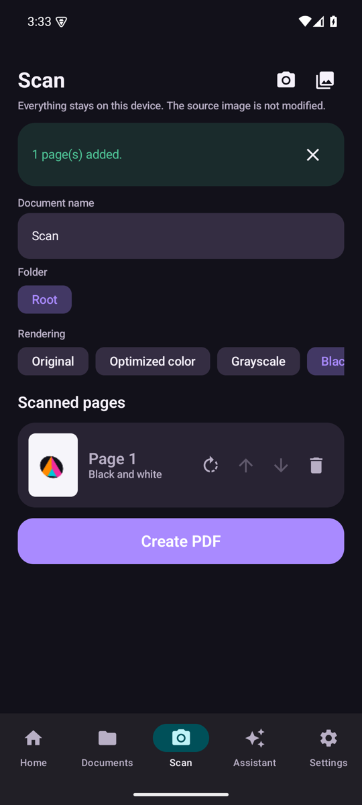
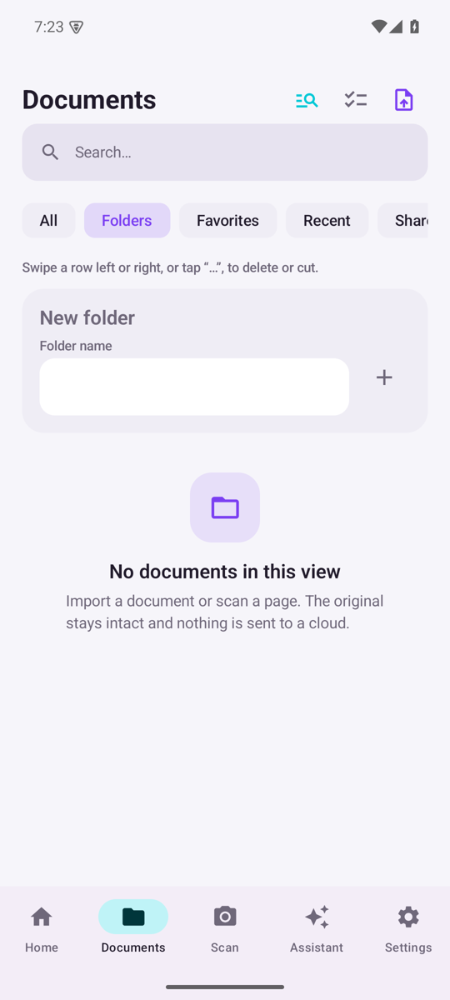

# Prism — APK (Android)

Gestionnaire documentaire **local-first** : import, lecture PDF, dossiers, scan du téléphone,
OCR on-device, opérations PDF non destructives et assistant local sourcé. Sans compte et sans
cloud IA par défaut.

## Télécharger

**[Prism v0.0.5 — APK debug](https://github.com/ilkinsem/Prism-Releases/releases/download/v0.0.5/app-debug.apk)**

- Android 8.0+ (`minSdk 26`), cible Android 15 (`targetSdk 35`).
- APK signé debug, à installer en sideload (autoriser les sources inconnues).
- Taille : ~71 Mo. SHA-256 : `de40f9c01467369a122d356c4a64e8a8f5d6e6e5f0b2dd20a189b75af5be9d73`.

Le dépôt de code source est **privé**. Ce dépôt public ne contient que les APK et leurs notes.

## Nouveautés v0.0.5

- **Recadrage avant PDF** : après une photo ou un import d'image, déplacez les 4 coins pour
  corriger la perspective, choisissez Couleur/Gris/Noir & blanc, saisissez le titre du document,
  puis validez la page. Le PDF utilise l'image recadrée et le rendu choisi.
- Imports multiples : file d'attente, « Reprendre » passe à l'image suivante.
- Rappel v0.0.4 : splash sombre, accueil logo/Bonjour, scanner haut, navigation corrigée,
  swipe et « … » sur l'accueil.
- Rappel v0.0.3 : mises à jour au démarrage/manuel, champs sans contour.
- Rappel v0.0.2 : scan du téléphone, gestes Documents.

## Nouveautés v0.0.3

- **Mises à jour** : vérification au démarrage, au retour au premier plan après 6 h, et manuelle
  dans Réglages. Bandeau non modal + téléchargement de l'APK via le navigateur.
  Requête HTTPS vers GitHub Releases, sans identifiant ni contenu documentaire.
- **Champs et filtres sans contour** : fonds distincts en clair/sombre, plus aucune bordure.

## Inclus

- Accueil, Documents, Scanner, Assistant, Réglages — **FR/EN**.
- Design Prism, thèmes clair/sombre, panneaux adaptatifs sans modale applicative.
- Import SAF, dossiers/sous-dossiers, favoris, récents, corbeille, tags, recherche nom/contenu,
  doublons SHA-256.
- Lecteur PDF : zoom, miniatures, texte, recherche, rotation, extraction/suppression, division.
  Chaque transformation crée un nouveau document ; l'original reste intact.
- Scanner CameraX + PDF multipage + OCR ML Kit.
- Assistant extractif sourcé (résumé, Q/R citées, extraction dates/montants/e-mails/références),
  multi-documents, historique et purge.
- Abstraction LLM : moteur embarqué par défaut ; Ollama/LM Studio debug-only, opt-in, hôtes privés.
- Prism est déclarée comme lectrice de PDF (`ACTION_VIEW` + `application/pdf`).

## Limites assumées

DOCX→PDF (moteur de rendu non embarqué), LFM3/llama.cpp natif Android, mesure OCR CER/WER,
Google Drive, signature cryptographique, caviardisation réelle, sync et performances sur appareil
physique. L'option « tous les fichiers » est avancée et doit être évaluée vis-à-vis des règles
Google Play avant une distribution publique.

## Vérifications

- E2E Compose : 7/7 (navigation, lecteur, dossiers, assistant, recherche, purge, swipe, scan).
- Vérification réelle des mises à jour contre l'API GitHub Releases.
- Couverture : domaine 91,8 %, core common 85,1 %.
- Build, installation et lancement vérifiés sur émulateur API 35.

Nom « Prism » provisoire. Version 0.0.5.
